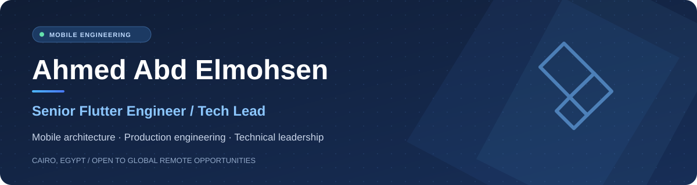

  

   

  

   

  **I architect, build, and scale production-grade Flutter applications.**

  [**Portfolio ↗**](https://ahmedabdelmohsen.vercel.app/) &nbsp;·&nbsp; [**LinkedIn ↗**](https://www.linkedin.com/in/ahmedmohamedabdelmohsen/) &nbsp;·&nbsp; [**Email ↗**](mailto:ahmedm.abdalmohsen@gmail.com)

---

### Engineering impact

| **10+** production apps | **5** engineers led | **30%** fewer crashes | **80%** faster deployments |
| :---: | :---: | :---: | :---: |
| HR, education, travel, transportation & marketplaces | Mentoring, code review & technical direction | Up to 30% reduction through optimization | Azure DevOps CI/CD automation |

### About me

I'm a **Senior Flutter Engineer & Tech Lead** based in Cairo, Egypt, with **6+ years of mobile engineering experience** and contributions to products serving **7,000+ users collectively**.

I work across the full application lifecycle — architecture, implementation, API integration, performance, releases, and engineering leadership. I care about **maintainable systems, dependable delivery, and measurable results**.

### Areas of expertise

| | |
| --- | --- |
| **Flutter engineering** | Flutter, Dart, adaptive UI, iOS & Android delivery |
| **Architecture** | Clean Architecture, MVVM, modular design, SOLID, dependency injection |
| **State & data** | Bloc/Cubit, Provider, GetX, SQLite, Hive, secure storage |
| **Integrations** | REST APIs, Dio, WebSockets, Firebase, payments, in-app purchases |
| **Release engineering** | Azure DevOps, CI/CD, Fastlane, Firebase App Distribution, Shorebird |
| **Beyond mobile** | ASP.NET Core, C#, SQL Server, technical leadership & code reviews |

### Selected production work

> These are **commercial products**. The links below lead to project presentations, not claims of open-source code availability.

| Product | What I worked on |
| --- | --- |
| **Circle HR** · HR management | Mobile architecture, employee requests, approvals & role-based workflows · **500+ users** |
| **Edu-Gamer** · Gamified learning | Interactive learning, Rive animations & in-app purchases · **200+ users** |
| **Domazone** · Marketplace | Buying/selling workflows, secure payments & store releases · **5,000+ users** |
| **Mozakrety** · E-learning | Video learning, assessments, subscriptions & playback optimization |
| **OGSET** · Assessment | Timed exams, randomized questions & answer tracking |
| **Zh-Transportations** · Transportation | Route management, scheduling & booking workflows · **1,000+ users** |

**Explore screenshots, demonstrations, and project details → [Selected portfolio projects](https://ahmedabdelmohsen.vercel.app/#projects)**

### Experience

**Mashura Consultants**

- **Flutter Tech Lead** · Jan 2025 – Present — Lead and mentor five Flutter developers, define mobile engineering practices, and remain hands-on.
- **Senior Flutter Engineer** · Jan 2023 – Dec 2024 — Delivered production applications, improved reliability, and automated delivery pipelines.
- **Mid-Level Flutter Developer** · Apr 2021 – Dec 2022 — Built and maintained Flutter applications and API integrations.

Earlier: iOS training at **Information Technology Institute (ITI)** and Android development training for students.

### Engineering principles

**Simple boundaries. Tested behavior. Observable failures. Repeatable delivery.**

I favor pragmatic architectural decisions over unnecessary abstraction, with attention to readable code, error handling, performance, and long-term ownership.

---

  <b>Let's build mobile software that lasts.</b>  
  Open to senior engineering, technical leadership, architecture consulting, and international remote collaboration.  
  <a href="https://ahmedabdelmohsen.vercel.app/">Portfolio</a> · <a href="https://www.linkedin.com/in/ahmedmohamedabdelmohsen/">LinkedIn</a> · <a href="mailto:ahmedm.abdalmohsen@gmail.com">Contact</a>

